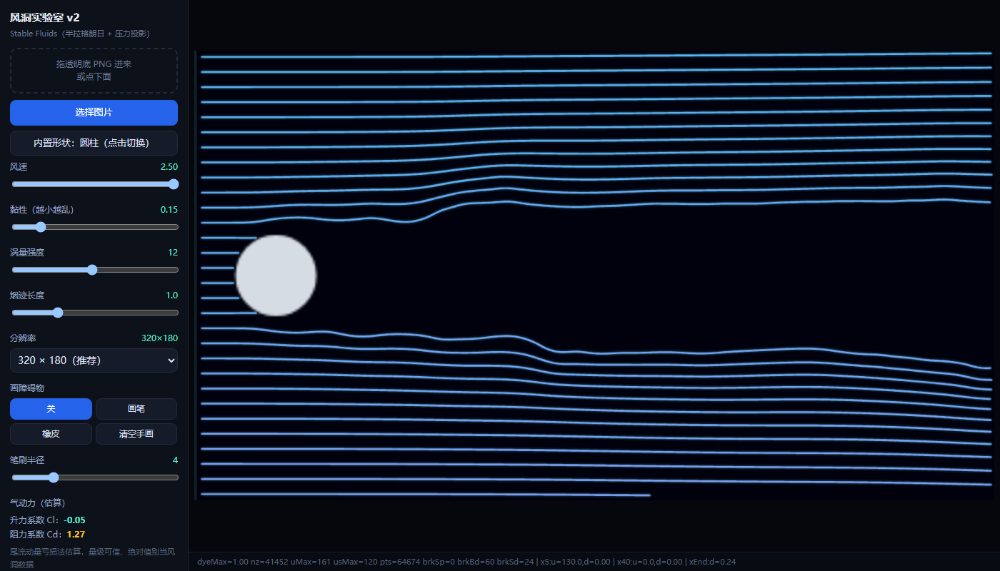
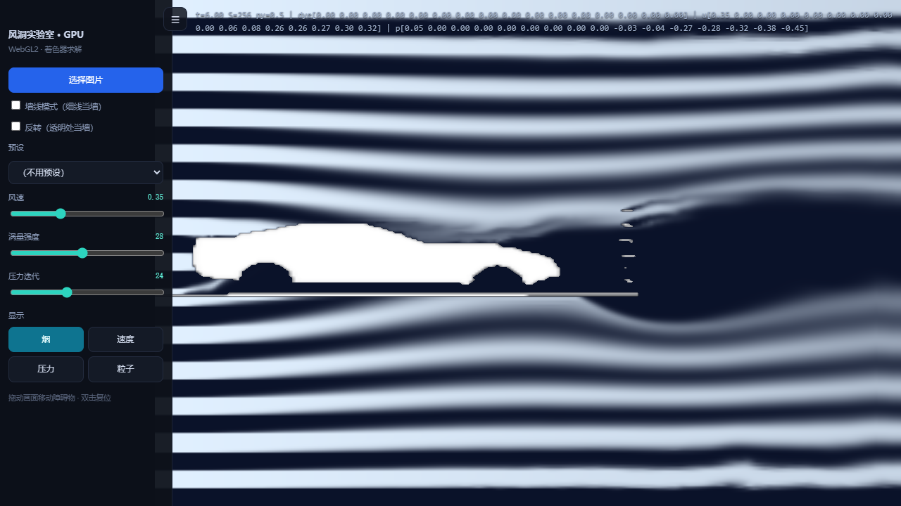
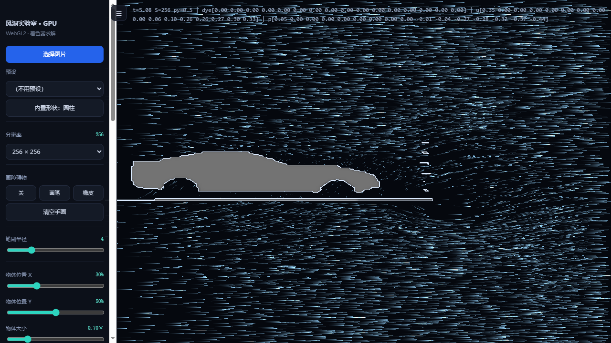
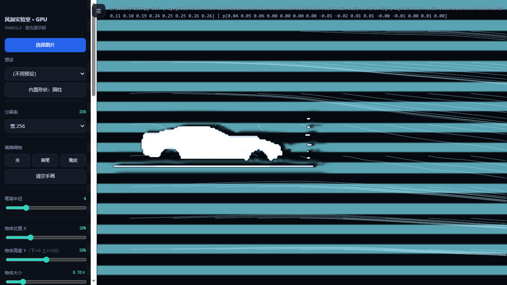
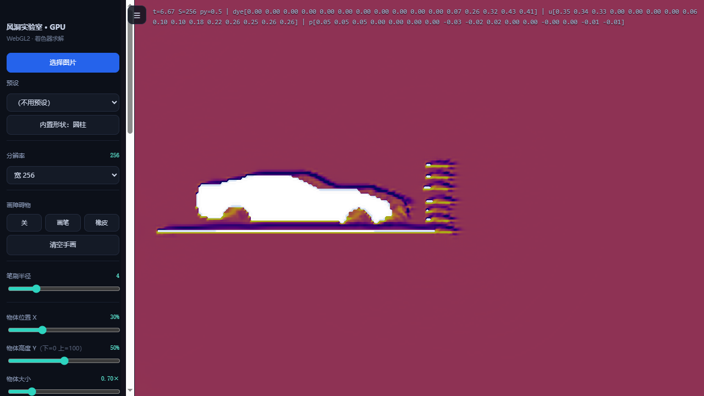
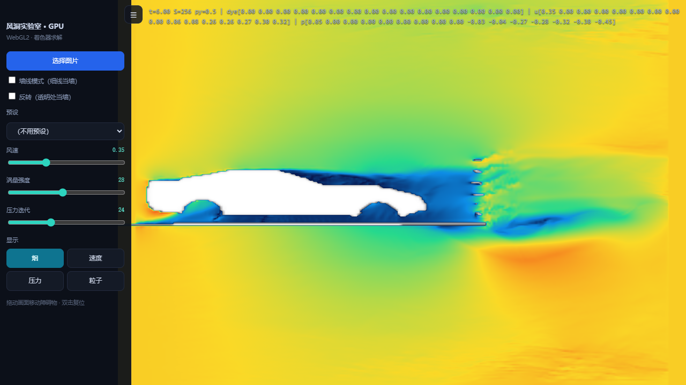
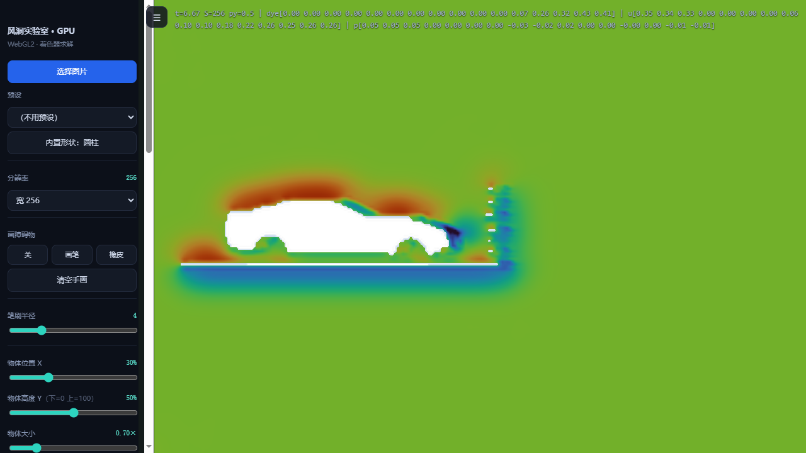
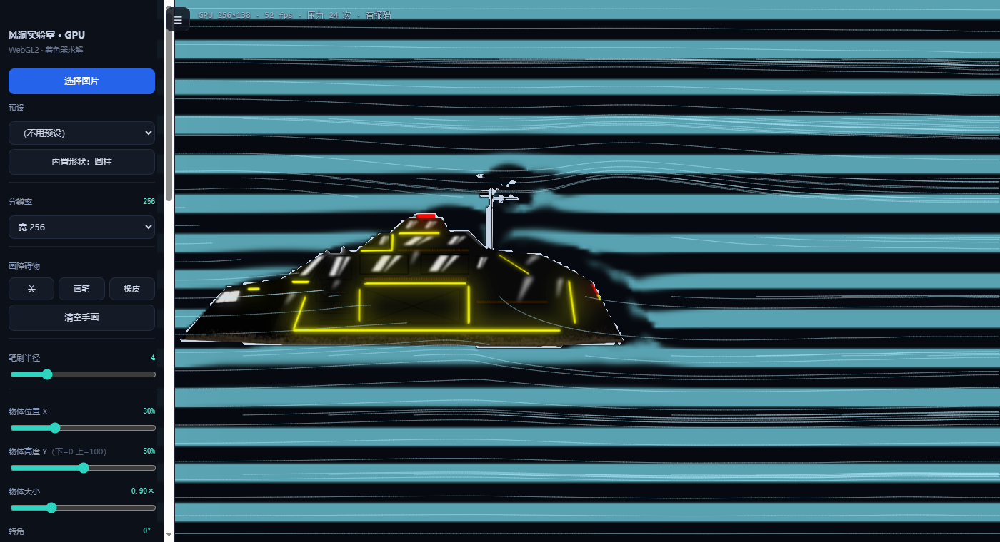
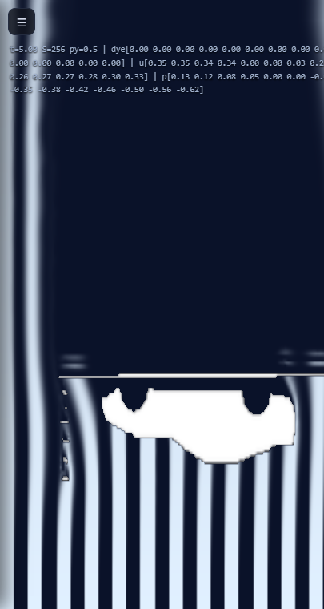

# 风洞实验室 · Wind Tunnel Laboratory

把一张**透明底 PNG** 放进风洞：不透明的像素当成实体，风从左边吹来，
绕过它、在尾部留下尾流和涡街。可以拖动摆放、直接画障碍物、读气动力系数。

**在线玩**：<https://whalemiao.github.io/Wind-Tunnel-Laboratory/>

| 平台 | 下载 | 说明 |
| --- | --- | --- |
| 🌐 网页 | [直接打开](https://whalemiao.github.io/Wind-Tunnel-Laboratory/) | 手机/电脑都能用 |
| 📱 安卓 | [wind-tunnel-lab.apk](https://whalemiao.github.io/Wind-Tunnel-Laboratory/wind-tunnel-lab.apk) | 约 275 KB，debug 签名，允许「未知来源」即可装 |
| 💻 Windows | [WindTunnelLab.exe](https://whalemiao.github.io/Wind-Tunnel-Laboratory/WindTunnelLab.exe) | 约 63 MB 单文件，自带运行时，双击即用 |

三个都在同一个 [Release](https://github.com/whalemiao/Wind-Tunnel-Laboratory/releases) 里。



## 这是什么

一个**纯前端的 2D 不可压流体模拟**，专门用来做"风洞可视化"：

- 上传的图片 → 用 alpha 通道当**固体边界**
- 求解 **Navier–Stokes**（Stable Fluids，Stam 1999），**CPU 和 GPU 两套求解器**
- 可视化：流线 / 脉线 / 条纹烟 / 涡量 / 速度 / 压强
- 可以调风速、黏性、涡量强度、烟迹长度、亮度、网格分辨率

**没有依赖、没有构建步骤**：一个 `index.html` 打开就能跑。

## 两个求解器

`index.html` 只做一件事：**探测设备能力，然后选一个求解器**。

```
index.html ──有 WebGL2 + EXT_color_buffer_float──→ gpu/gpu-fluid.html   GPU 版
           └─没有（或 ?cpu=1）──────────────────→ cpu.html            CPU 版
```

| | GPU 版 `gpu/gpu-fluid.html` | CPU 版 `cpu.html` |
| --- | --- | --- |
| 求解器 | 全部在着色器里（浮点渲染目标 ping-pong） | JS，Stable Fluids |
| 网格 | 512² 起，可到 1024²（界面可切，原地重建） | 240~800（可调） |
| 显示层 | 场（压强/速度/**涡量**）+ 烟 + 粒子（**流线**/脉线/随机） | 同样的三层，六种看法 |
| 交互 | 拖图/画笔/内置形状/缩放旋转/气动力/保存这一帧 | 一样 |
| 速度 | 同分辨率下高一个量级 | 640×360 以上开始掉帧 |
| 兼容性 | 要 WebGL2 + 浮点渲染 | 有 Canvas 2D 就行 |
| 调试 | `?warm=N` 确定性探针、`?selftest=1` 自检（见 [gpu/README.md](gpu/README.md)） | `?still=` / `?dbg=1` |

GPU 版在跑不动或不被支持时会**自动退回** CPU 版；想手动对比就加 `?cpu=1`。

| GPU 版 · 条纹烟 | GPU 版 · 粒子（速度方向短线） |
| --- | --- |
|  |  |

| GPU 版 · 流线 + 烟 | GPU 版 · 涡量 |
| --- | --- |
|  |  |

| GPU 版 · 速度 | GPU 版 · 压力 |
| --- | --- |
|  |  |

| GPU 版 · 导入图片（原图直接画，不糊） | GPU 版 · 竖屏（物体长轴顺着风） |
| --- | --- |
|  |  |

> 画笔/橡皮的落点、物体摆放、图片朝向都有 `?selftest=1` 的数字回归（15 项），
> 无头截图拍不到 boot 阶段的绘制，这几项看数字就行。

## 用法

```
直接打开 index.html
或用任意静态服务器（例：python -m http.server）
```

- 拖一张**透明底 PNG** 进去，或点「选择图片」
- **画布上拖动**移动物体，**滚轮**缩放，**Shift+滚轮**旋转
- 「画笔 / 橡皮」直接在画布上画障碍物（笔刷半径可调）
- 「内置形状」每点一次循环切换：圆柱 → 翼型 → 水滴

### URL 参数

（下面是 CPU 版 `cpu.html` 的参数；GPU 版的在 [gpu/README.md](gpu/README.md)，最常用的是 `?warm=N` 和 `?view=`）

```
?mode=stream|streak|stripes|curl|speed|pressure
?shape=circle|airfoil|teardrop
?speed=1.2&visc=0.15&vort=10&life=1&bright=0.7
?ox=0.3&oy=0.5&scale=1&angle=0
?res=240x135|320x180|400x225|480x270|640x360|800x450
?img=test-tank.png        # 直接加载一张图当物体
?still=1200               # 跑固定帧数后出静帧（截图用，不启动动画）
?dbg=1                    # 底部显示中间量（排查"场是不是死了"）
```

例：

```
?img=test-tank.png&mode=stripes&speed=1.4&res=400x225
```


## 已知问题 / 后续计划

### 已知问题

| 问题 | 影响 | 状态 |
| --- | --- | --- |
| 手机高分辨率（640×360 以上）帧率掉到 20-25 | 拖动时会觉得卡 | CPU 版的问题；GPU 版同分辨率下高一个量级，但**还没在真机上验过** |
| GPU 版显示层比 CPU 版少（缺流线/涡量） | 少两种看法 | 见 [gpu/README.md](gpu/README.md) 的下一步 |
| 气动力只是量级可信 | `Cd` 绝对值不能当风洞数据用 | 有意为之，界面已标注 |
| 涡街在低黏性下会"糊"成一片 | 看不出清晰涡对 | 需要更高网格 + 更久演化 |
| WebView 壳不支持系统分享 | 不能一键把当前画面发给别人 | 计划加"保存这一帧"导出 |
| APK 是 debug 签名 | 不能上架应用商店 | 个人分发够用 |

### 后续计划

- [ ] **场景保存 / 分享链接**：把当前物体、参数编码进 URL
- [ ] **预设形状**：汽车、岩石、机翼几组常用障碍物
- [ ] **转子工具**：画一个会转的叶片，看它搅动气流
- [ ] **导出**：PNG 截图 / GIF 动图
- [ ] **自适应分辨率**：掉帧时自动降网格，而不是让用户手动调
- [ ] 可选的正式签名（如果要上应用商店）

> 有想加的功能或者发现上面没列的问题，欢迎在
> [Issues](https://github.com/whalemiao/Wind-Tunnel-Laboratory/issues) 提，
> 或者到 [B 站](https://space.bilibili.com/3546600242678059) 私信。

## 更新日志

每次发布的改动都记在 [CHANGELOG.md](CHANGELOG.md)；
Release 说明由 CI 从对应版本段自动提取。


## 物理

- 不可压 Navier–Stokes，**Stable Fluids**（Stam 1999）
- 每帧：涡量约束 → 半拉格朗日对流 → 20 次 Jacobi 压力投影 → 边界条件
- 固体单元速度归零 + 贴壁摩擦
- 涡量 ω = ∂v/∂x − ∂u/∂y
- 流线用**平滑后的速度场 + RK2 中点法**积分（步长 0.7 格，每步限转角 4°）

### 气动力（估算）

用**尾流动量亏损法**（风洞实验里的真实做法），不是表面压力积分：

```
Cd ≈ ∫ u(U − u) dy / (0.5·U²·H)
Cl ≈ ∫ u·v      dy / (0.5·U²·H)
```

为什么不用压力积分：Stam 求解器里的 `p` 是"伪压力"，只保证梯度正确、
绝对值没有物理单位 —— 直接积分会算出 `Cd=1245` 这种没意义的数。

**量级可信，绝对值别当风洞数据。**

## 渲染：网格 ≠ 画布

```
物理网格：240~800（可调）
画布像素：网格 × RS，RS 按窗口宽 × devicePixelRatio 算（1~6）
```

标量场先画在网格分辨率，再**开插值放大**；流线/粒子直接在高分画布上画。
导入的图片**每次都用原图按画布像素绘制**，不在中间缩一次。

## 踩过的坑（都写在代码注释里）

| 症状 | 根因 |
| --- | --- |
| 流线像闪电一样抽搐 | 最近邻采样 + 涡量约束放大噪声 + 每帧方向微变 → 双线性 + 5×5 空间平滑 + **时间低通** |
| 换分辨率后图片变回默认形状 | 用 `location.reload` 换分辨率，图片只在内存里 → 改成**原地重建** |
| 拖动时物体留残影 | 累积层和物体画在同一层 → **分层**：累积层只放烟，主画布每帧重画 |
| 拖到的地方轨迹失踪 | 拖动时整片清烟 → 改成**加速淡出**（0.06 → 0.22） |
| 条纹烟整片纯蓝 / 流线一条没有 | 「不重置流场」把**首次初始化**也跳过了 → 加 `flowInited` 标志 |
| 平滑后流线全没了 | 平滑范围写成 `R..NX-R`，**边界一圈是 0** → 覆盖 `1..NX-2` |
| 18px 的 B 站图标变成灰疙瘩 | CSS `fill: currentColor` 继承到描边图标内部 → `fill` 要写在具体元素上 |

**一条通用规律**：

> **会累积的东西放一层，每帧都要重画的东西放另一层。**
> 混在一层里，就一定会互相污染。

## 文件

```
index.html          入口：探测能力，选 GPU 版或 CPU 版
cpu.html            主程序 · CPU 版（Canvas 2D + JS 求解器，兼容旧设备）
gpu/gpu-fluid.html  主程序 · GPU 版（WebGL2 着色器求解，四层显示 + 粒子）
gpu/README.md       GPU 版交接单：状态、探针用法、已知坑、下一步
gpu/probe.ps1       数值探针：无头浏览器跑 ?warm=N 后读回一行数字
v1-lbm.html         第一版：格子玻尔兹曼（保留对比，会有"Q弹"感）
test-tank.png       示例素材（1191×515，透明底）
shots/              截图
```

## 协作方式

这个项目是和 AI 结对做的（一天之内从"能不能做成 apk"做到三端上线）。
下面的约定是踩出来的，**下次继续开发前先读这一节**。

### 一、开工前先搜现成的

> **先检索，再实现。**

我们花了整整两天手写 CPU 流体求解器，后来在 GitHub 上花 20 分钟
找到 [PavelDoGreat/WebGL-Fluid-Simulation](https://github.com/PavelDoGreat/WebGL-Fluid-Simulation)
（MIT）——它的架构和参考 app 几乎一致。

正确的顺序是：**需求 → 搜同类项目 → 选最接近的改 → 不行再自己写**。

### 二、状态写在文件里，不留在对话里

AI 的上下文是**工作内存**，会被压缩（有损）；文件是**硬盘**。

| 该写进文件的 | 只该留在对话里的 |
|---|---|
| 当前版本、下一步、已知 bug | 临时推导 |
| 踩过的坑与结论 | 试错的中间过程 |
| 验证方法（URL / 参数 / 期望输出） | 调试时的猜想 |

**每次收工前写一份交接单**，格式：

```markdown
### ⚠️ 第一件：<当前卡住的具体问题>
现象：…（含关键数字）
判断：…（已排除什么）
一步验证：…（改哪行、看什么）
验证 URL：http://...
```

实例见 [`gpu/README.md`](gpu/README.md) 的 `## 待办（交接单）`。

### 三、用数字代替截图

调试时优先跑**探针**，而不是反复截图：

```
?probe=1   用 readPixels 读回真实数值（u=0.356 dyeMid=0.972）
?dbg=1     把中间量打到状态栏
```

一张截图 1-2k tokens 且只能看大概；一行数字几十 tokens 且能精确到小数。
**"修好了"要有数字证据，不能只说"看起来对了"。**

### 四、按子系统拆场次

```
一场：物理/求解器
一场：UI / 交互
一场：打包与发布
```

每场只带自己那部分上下文，互不挤占。

### 五、改动前先验证，改完必须有证据

本项目所有修复都配了可复现的验证命令：

```bash
# 例如：验证多分辨率是否生效
?dbg=1   →  grid=320x180 dye=640x360
```

**没有验证方式的"修好了"不算修好。**

## 参考

界面上参考了 [WindTunnel（Algorizk）](https://play.google.com/store/apps/details?id=com.algorizk.windtunnel)
的功能划分（流线/脉线/条纹烟/涡量/速度/压强、可调黏性与网格）。

求解器实现参考 Jos Stam, *Stable Fluids*, SIGGRAPH 1999。

## License

MIT

## 安卓 APK

`android/` 是一个最小的 WebView 壳（Java，无 Kotlin），构建前会把仓库根的
`index.html` / `cpu.html` / `gpu/gpu-fluid.html` / `test-tank.png` / `presets/` 拷进 `assets/`
—— **网页只维护一份**。

本地构建（需要 Android SDK + JDK 17）：

```bash
cd android && gradle assembleDebug
# 产物：app/build/outputs/apk/debug/app-debug.apk
```

CI 构建：推送到 `main` 时 `.github/workflows/android.yml` 自动编译，
产物发到 Release `apk-latest` 和 Actions artifacts。

**为什么是 debug 签名**：发布签名需要 keystore + 密码，不适合放进公开仓库。
debug 签名能正常安装，只是不能上架应用商店。

## 手机适配

- 侧边栏在窄屏（≤820px）变成抽屉，左上角 ☰ 打开，点遮罩关闭
- 画布 `touch-action: none` + 阻止默认滚动 → **手机能拖动 / 滚轮缩放 / 旋转物体**
- 状态栏在手机上只保留 GitHub / B 站图标